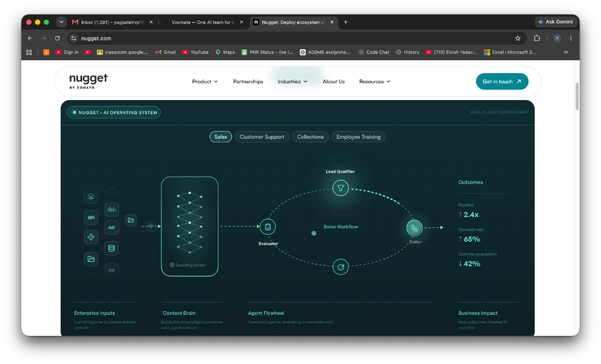

# Web Agents Required Improvements

## 1. The Current Problem

*Note to IDE / Agents: Always refer back to our previous conversations and this document to understand the full context before making architectural changes.*

### Problem Statement
Our web agent is struggling with conversational accuracy, context awareness, and hallucinations. Specifically:
1. **Speech-to-Text (STT) Inaccuracies:** The system is frequently mishearing words (e.g., "his roommate" instead of "Voomate", "Vy" instead of "By").
2. **Context Blindness & Hallucinations:** The agent does not know what page the user is currently on. When a user asks about something they can't see, the agent hallucinates generic advice (e.g., "please sign in to your Voomate account") even when the user is *already* in the dashboard. 
3. **Incorrect Terminology:** The agent uses SDK/code-level names instead of the exact, user-facing UI tab names, causing severe user confusion.

### Chat Logs of the Web Agent Failure
> **User:** "OK, so can you just tell me what is his roommate and how to set up this."
> **Agent:** "Overview is A live Operating Panel for active agents, SDK health, recent conversations, connections, approvals, and usage. Start with Agents to configure the team, Integrations to connect business systems, and Logs to see what each response consulted and why."
> **User:** "Vy overview, I can't see any overview panel."
> **Agent:** "To access the overview panel, please sign in to your Voomate account and navigate to the dashboard. The overview panel should be visible on the dashboard. If you are unable to see it, please ensure that you have the necessary permissions and that your account is active. If the issue persists, please contact Voomate support for further assistance."

### Required Actions for a Robust System
1. **Page Context Injection:** Build a robust system where the agent is explicitly fed the user's *exact current page* and the *exact UI tabs available*.
2. **UI-Verification Logic:** The agent must check its page context to see if a feature/tab actually exists before hallucinating navigation instructions.
3. **Terminology Mapping:** Map backend SDK/code names to exact user-facing UI labels so the agent speaks the user's language.
4. **Enhanced STT / NLP Tolerance:** Implement code intelligence steps to handle STT errors gracefully (e.g., fuzzily matching "his roommate" to "Voomate" based on context).

### Problem 2: Latency & TTS Synchronization
Our agents are experiencing significant delays, severely impacting the real-time conversational experience. Specifically:
1. **High Text Latency:** Text responses are taking 3-4 seconds to generate, which is far too long for a chat bot. We need sub-second latency.
2. **Desynced Voice (TTS):** In the voice agent, the text transcript appears early, but the Amazon Polly audio stream is delayed, creating a disjointed user experience.
3. **Geographic Routing:** The current infrastructure might be routed far from our primary users, causing unnecessary network overhead.

### Required Actions for Sub-Second Latency
1. **Migrate Infrastructure to India Region:** Shift the AWS services (Bedrock, Polly) and the PostgreSQL Database to India-based servers (e.g., `ap-south-1`) to drastically reduce round-trip ping times for our primary user base.
2. **Optimize Streaming Pipelines:** Investigate the Node.js to Python WebRTC bridge to ensure the Polly audio chunks are streamed and played instantly alongside the text deltas, rather than buffering.
3. **Database Query Optimization:** Ensure that any database queries fetching the `pageContext` or user session state are optimized and edge-cached if necessary to meet the sub-second requirement.

### Problem 3: Fragmented Navigation & Unifying the Framework (CTO Vision)
Currently, navigation works on some pages (like the landing page successfully navigating to "Pricing") but fails on others (like the dashboard failing with "The agent cannot perform navigation actions" when asked to go to the inbox). The current architecture is fragmented.
1. **Inconsistent Capabilities:** The Web Agent must be able to confidently navigate the user across *any* application it is embedded in, using the exact same framework.
2. **Divergent Voice vs. Text Logic:** The voice agent and text chat should not use different logic, stacks, or capabilities. They must be perfectly unified.

### Required Actions for the Unified "Agentic Tab" Architecture
*(Thinking like a CTO to future-proof the vision)*
1. **Universal Navigation Engine:** We will build a single, universal `clientCommands` and `pageContext` matching engine that powers navigation across the Landing Page, the Dashboard, Voice, Text, and all future Client deployments. If a page exists in the local manifest, the agent *will* find it, regardless of typos.
2. **Unified Omnichannel Stack:** We will consolidate the Voice and Text processing paths. Voice will simply be an audio interface on top of the exact same deterministic orchestration layer that powers the text chat, ensuring 100% feature parity.
3. **Cross-Domain Context Sharing:** By unifying this into an agnostic framework, our agents can intelligently operate across domains—meaning the same core intelligence powers our marketing site, our logged-in dashboard, and our B2B customers' sites without rebuilding the logic for each service.

### Problem 4: Hardened Multi-Tenant Isolation (Inspection Findings)
I have inspected your database architecture in `client.ts` and `10_rls_policies.sql`. Currently, your API connects to Supabase using the **Service Role**, which *completely bypasses* Postgres Row-Level Security (RLS). Isolation relies entirely on developers manually adding `tenantScope()` to every database query. If a single developer forgets to append this scope to a query, clients will see each other's agents and data.
1. **App-Layer Vulnerability:** Relying purely on the Node.js application layer (`tenantScope`) to prevent data merging is risky for a multi-tenant B2B platform.
2. **Missing DB-Layer Enforcement:** RLS policies exist in your database, but they are completely ignored by the backend API.

### Required Actions for Absolute Multi-Tenant Isolation
1. **Session-Level Database Enforcement:** Instead of bypassing RLS with a Service Role, we will use Postgres configuration variables (`set_config('app.current_tenant', ...)`). We will wrap all Drizzle database queries in a transaction that sets the current `organizationId` directly in Postgres.
2. **Fail-Safe RLS:** We will update the RLS policies so that the database engine itself rejects any query attempting to read or write an agent belonging to a different client. Even if a developer writes a completely unscoped query like `select * from agents`, the database will automatically filter it. This guarantees clients and their agents never get merged.

### Problem 5: Dynamic Role & Portal Boundary Isolation (Multi-Dashboard Scope Blindness)
When an enterprise or B2B application contains multiple distinct portals or dashboards under the same root domain (e.g., **Super Admin Portal** at `/admin/*`, **Merchant Admin Dashboard** at `/app/*` or `/`, and **Customer Storefront** at `/store/*` or `/account/*`), the Web Agent currently suffers from **Scope Blindness**. It fails to isolate the active role and layout boundaries, causing cross-portal hallucinations and navigational collisions.

```
┌───────────────────────────────────────────────────────────────────────────────────────────────────┐
│                                 MULTI-PORTAL SCOPE ARCHITECTURE                                   │
├───────────────────────────────┬─────────────────────────────────┬─────────────────────────────────┤
│    👑 Super Admin Portal      │   🏢 Merchant Admin Dashboard   │     🛍️ Customer Storefront       │
│         (/admin/*)            │          (/ or /app/*)          │          (/store/*)             │
├───────────────────────────────┼─────────────────────────────────┼─────────────────────────────────┤
│ • Merchants & Workspaces      │ • Agents & AI Config            │ • Product Catalog & Search      │
│ • Agent Fleet & LLM Routing   │ • Connections & Integrations    │ • Shopping Cart & Checkout      │
│ • Pipecat Voice Studio (7860) │ • Customer Conversations Inbox  │ • Order Tracking & Lookups      │
│ • Telephony & WebRTC Relays   │ • Team Approvals & Feedback     │ • Return & Shipping Policies    │
│ • Cluster Health & Audit Logs │ • Organization Settings         │ • Customer Support Inquiries    │
└───────────────────────────────┴─────────────────────────────────┴─────────────────────────────────┘
```

#### Real Chat Log of the Web Agent Scope Collision (Super Admin Failure)
> **Active User URL:** `http://localhost:3001/admin/merchants` (Super Admin Portal)  
> **User Prompt:** `"hey can you aplc redirect this to agabt fellet page"` *(Intent: Navigate to Super Admin Agent Fleet `/admin/agents`)*  
> **Flawed Agent Response:** `"I couldn't safely match that to a page here. I can open Overview, Agents, Web Agent, Voice Calling Agent, Integration Agent, Integrations, Conversations, Logs."`  
> 
> ❌ **Root-Cause Analysis of the Failure:**  
> 1. The user was inside the Super Admin portal (`/admin/*`), but the agent attempted to resolve the destination against a static, out-of-scope **Merchant Dashboard** manifest.  
> 2. It failed to recognize compound typos (`"agabt fellet"` ➔ `"Agent Fleet & LLMs"`).  
> 3. It leaked merchant navigation links inside the super admin console, breaking boundary security and confusing the operator.

#### Why This Is a Critical Flaw for Multi-Tenant B2B Platforms
A single customer project rarely has only one screen. In production multi-tenant environments:
1. **Super Admin / Platform Team:** Manages client accounts, LLM model routing, telephony infrastructure, and billing quotas (`/admin/*`).
2. **Merchant / Workspace Admin:** Configures their own store's voice bots, knowledge base, integrations, and team permissions (`/app/*` or `/`).
3. **End-User / Customer:** Browses products, adds items to cart, checks order status, and asks store policy questions (`/store/*`).

If the Web Agent is scope-blind, it leaks internal operational links to public customers, or leaks merchant settings to super admins, completely breaking trust and multi-tenant isolation.

---

### Deep Technical Specification & Architecture (CTO Blueprint)
*(Zero-Config, Dynamic Framework Adapting Automatically to Any Client's Codebase)*

#### 1. DOM-Native Active Navigation Discovery Engine (`widget.js`)
- The embed widget runtime must dynamically scrape navigation targets from the *currently mounted* semantic HTML elements on the host DOM (`aside nav`, `header nav`, `[role="navigation"] a[href]`, `[data-sidebar] a[href]`).
- It extracts the `href`, `aria-label`, visible text, and active hierarchy tags.
- It attaches an auto-discovered `portalScope` (e.g. `/admin`, `/app`, `/store`, or `/`) derived from `window.location.pathname.split('/')[1]`.

#### 2. Dynamic Portal Boundary Partitioning (`destination-resolver.ts`)
- Destinations are dynamically partitioned by path hierarchy.
- **Portal Affinity Scoring:** If the active user session is at `/admin/*`, any destination starting with `/admin/` receives an automatic `+15` affinity bonus, ensuring super admin destinations always take precedence over sister-portal links.
- **Strict Fallback Scope Isolation:** When a destination cannot be matched, the direct fallback message (`"I can open..."`) filters its advertised list strictly to routes within the active `portalScope`. Super Admin users will ONLY ever be shown Super Admin pages.

#### 3. Compound Phonetic Typo Tokenizer (`destination-resolver.ts`)
- Multi-token Levenshtein distance with canonical token phonetic normalization:
  - `"agabt"` / `"agant"` / `"againt"` / `"aganit"` ➔ `"agent"`
  - `"fellet"` / `"fleat"` / `"fllet"` / `"fleet"` ➔ `"fleet"`
  - `"marchant"` / `"merchent"` ➔ `"merchant"`
  - `"supr"` ➔ `"super"` | `"admn"` ➔ `"admin"` | `"telefoni"` ➔ `"telephony"`
- Compound matcher computes token-pair alignments: `"agabt fellet"` aligns with `"Agent Fleet & LLMs"` (`/admin/agents`) with a high confidence match.

#### 4. Role-Aware Context & Persona Calibration (`turn.ts` & `nova.ts`)
- The orchestrator injects the active `portalScope` into the LLM system context.
- System prompt dynamically calibrates without manual code changes:
  - **In `/admin/*`:** Operates as the **Platform Infrastructure Assistant** (focusing on tenant management, model routing, and cluster telemetry).
  - **In `/` or `/app/*`:** Operates as the **Merchant Workspace Assistant** (focusing on store agent setup, knowledge bases, and connections).
  - **In `/store/*`:** Operates as the **Customer Concierge** (focusing on product inquiries, order tracking, and checkout guidance).

---

### Data Contract & Schema Specification

```typescript
// Enriched WebAgentPageContext Schema (Zod-validated)
export interface EnrichedWebAgentPageContext {
  url: string;                           // e.g. "http://localhost:3001/admin/merchants"
  portalScope: '/admin' | '/app' | '/' | string; // Auto-derived root boundary
  activeRole: 'super_admin' | 'merchant_admin' | 'end_user';
  title: string;                         // Document title
  description?: string;
  headings: string[];
  navigation: Array<{
    label: string;                       // e.g. "Agent Fleet & LLMs"
    url: string;                         // e.g. "http://localhost:3001/admin/agents"
    portalScope?: string;                // e.g. "/admin"
    description?: string;
    aliases?: string[];                  // e.g. ["agent fleet", "llm fleet", "agabt fellet"]
    facts?: string[];
  }>;
  surface?: {
    id: string;                          // e.g. "admin-merchants"
    title: string;
    description: string;
  };
}
```

---

### 📋 Master Implementation Prompt (For Codex & IDE AI Agents)

```markdown
[CODEX & IDE AI AGENT INSTRUCTION]:
Implement Dynamic Role & Portal Boundary Isolation for the Voomate Web Agent architecture across all dashboards:

PHASE 1: CLIENT RUNTIME ENHANCEMENTS (`apps/dashboard/public/embed/v2/widget.js`)
1. In `collectPageContext()`:
   - Extract `portalScope` from `window.location.pathname.split('/')[1]` (e.g. "admin", "app", "store").
   - Query the active DOM for `<aside nav a[href]>`, `<header nav a[href]>`, and `[role="navigation"] a[href]`.
   - Tag each discovered navigation destination with its matching `portalScope`.
2. In `resolveClientNavigation()`:
   - Ensure URL path resolution works seamlessly with relative paths, hash variations, and cross-subpath navigation within the same host origin.

PHASE 2: ORCHESTRATION & DESTINATION RESOLVER (`apps/dashboard/src/lib/web-agent/`)
1. In `destination-resolver.ts`:
   - Implement `portalScope` affinity bonus (+15 score) for destinations sharing the active URL path prefix.
   - Expand `canonicalToken()` to normalize common compound typos ("agabt" -> "agent", "fellet" -> "fleet", "marchant" -> "merchant", "supr" -> "super", "admn" -> "admin").
   - Upgrade `navigationSubject()` to strip movement verbs including "redirect this to", "take me to", "lead me to", "switch to".
PHASE 3: MANIFEST & PROMPT CALIBRATION (`apps/dashboard/src/app/layout.tsx` & `nova.ts`)
1. Ensure `UI_MANIFEST` includes all primary portal routes (`/admin/merchants`, `/admin/agents`, `/admin/voice-studio`, `/admin/telephony`, `/admin/health`) with rich multi-word aliases.
2. In `nova.ts` and `bedrock-inline-agent.ts`, ensure `pageContext.portalScope` informs the system instructions so the agent naturally speaks in the context of the active portal.

PHASE 4: VALIDATION
1. Run `npm run typecheck` across all workspaces to guarantee 0 TypeScript errors.
2. Run navigation smoke tests verifying:
   - Querying "redirect to agent fleet" on `/admin/*` navigates to `/admin/agents`.
   - Querying "redirect to agents" on `/` navigates to `/agents`.
   - Typo query "agabt fellet" correctly resolves to "Agent Fleet & LLMs".
```

---

### Problem 6: Landing Page UI & Interactive Workflow Architecture Showcase (Tactile Operating Flow & Multi-Agent Execution)

#### 1. Visual Reference & Screenshot Teardown
To achieve world-class enterprise conviction and tactile UI depth, we are anchoring the redesign of our core operating flow (**"Install once. Understand everything. Act instantly."**) to the high-converting architectural blueprint shown below:



> **Visual Artifact Reference:** [`docs/assets/workflow-reference-ui.png`](file:///Users/yug/Desktop/ai%20voice%20agent%20project/docs/assets/workflow-reference-ui.png) | Public Path: [`/assets/workflow-reference-ui.png`](file:///Users/yug/Desktop/ai%20voice%20agent%20project/apps/landing/public/assets/workflow-reference-ui.png)
> **Live Architecture Benchmark Link:** [https://www.nugget.com/](https://www.nugget.com/) *(Analyze how the workflow organizes complex distributed systems into an intuitive, high-conviction 4-stage narrative).*

---

#### 2. Architectural Analysis of the Reference Workflow
The reference UI solves the exact communication challenge Voomate faces by organizing the real-time AI operating loop into **4 interconnected, visually rich columns**:

```
┌──────────────────────────────────────────────────────────────────────────────────────────────────────────────────────────────────┐
│ 🟢 VOOMATE • AI OPERATING SYSTEM                                                                 END-TO-END GOVERNANCE & METRICS │
├──────────────────────────────────────────────────────────────────────────────────────────────────────────────────────────────────┤
│                               [ E-Commerce & Retail ]  [ Customer Support ]  [ Lead Gen & Telephony ]  [ Agent Fleet ]           │
│                                                                                                                                  │
│  1. ENTERPRISE INPUTS         2. CONTEXT BRAIN               3. AGENT FLYWHEEL (ORBITAL LOOP)         4. BUSINESS IMPACT         │
│  ┌───────────────────────┐    ┌─────────────────────────┐              [ Intent / Qualifier ]         ┌────────────────────────┐ │
│  │ 🌐 Web SDK (<12kb)    │    │ ┌─────────────────────┐ │                        ▲                    │ ⚡ Response Latency    │ │
│  │ 🔌 REST / GraphQL API │    │ │  Neural Lattice     │ │                        │                    │    ↓ 78% (sub-800ms)   │ │
│  │ 🎙️ WebRTC Voice (7860)│ ──►│ │  Decision Matrix    │ │ ──►    [ Evaluator ] ──┼──► [ Caller/Web ]  │ 📈 Autonomous Rate     │ │
│  │ 📦 Shopify & ERP DB   │    │ └─────────────────────┘ │                        │                    │    ↑ 84%               │ │
│  │ 📞 SIP / PBX Gateway  │    │                         │                        ▼                    │ 🛡️ Tenant Isolation    │ │
│  │ 🛡️ PostgreSQL RLS DB  │    │  ⚡ Deciding Action     │                  [ Tool Sync ]              │    100% Enforced       │ │
│  └───────────────────────┘    └─────────────────────────┘                                             └────────────────────────┘ │
│                                                                                                                                  │
│  "Everything your business    "Builds the knowledge      "Specialist agents executing in               "Real outcomes, tracked   │
│   already runs on"             foundation per tenant"     complete synchronization"                    in real time"             │
└──────────────────────────────────────────────────────────────────────────────────────────────────────────────────────────────────┘
```

##### Core Structural Pillars:
1. **Top Header & Scenario Switcher:**
   - Header badge: `🟢 VOOMATE • AI OPERATING SYSTEM` with live pulse dot + `END-TO-END GOVERNANCE & TELEMETRY`.
   - Dynamic industry/scenario pills: `[ E-Commerce & Retail ]`, `[ Customer Support ]`, `[ Lead Gen & Telephony ]`, `[ Multi-Agent Fleet ]`. Selecting a pill updates the entire flywheel, active nodes, and live outcome metrics.
2. **Column 1 — Enterprise Inputs (Left Matrix):**
   - Floating grid of 8 connected icons representing real input sources: Web `<script>` SDK, REST/GraphQL APIs, WebRTC audio streams, Shopify catalog, SIP telephony, PostgreSQL DB, WhatsApp/Slack webhooks, and pgvector embeddings.
   - Animated SVG particle streams flowing into the Context Brain.
3. **Column 2 — Context Brain (Deciding Action Neural Lattice Card):**
   - Vertical glowing cockpit card with animated diamond lattice neural nodes.
   - Dynamic status pill `⚡ Deciding Action`.
   - Real-time engine tasks: Active DOM scrapers, RLS session isolation (`set_config('app.current_tenant')`), and sub-50ms vector RAG retrieval (`ap-south-1`).
4. **Column 3 — Agent Flywheel (Elliptical Orbital Execution Loop):**
   - Glowing elliptical orbital track with traveling photon particles.
   - 4 synchronized nodes executing continuously:
     - **Top Node:** `Lead & Intent Qualifier` (Target/Funnel icon)
     - **Right Node:** `Voice & Web Operator` (Headset/Browser icon)
     - **Bottom Node:** `Sync & Tool Executor` (Circular refresh icon)
     - **Left Node:** `Safety & RLS Evaluator` (Shield/Check icon)
   - Central glowing badge: `Active Execution Flywheel` displaying the live workflow name.
5. **Column 4 — Business Impact (Far-Right Real-time Outcomes):**
   - Clean editorial KPI metric stack:
     - **Resolution Latency:** `↓ 78% (sub-800ms)`
     - **Autonomous Action Rate:** `↑ 84% (Zero Human Routing)`
     - **Tenant Data Isolation:** `100% RLS-Enforced (Zero Bleed)`
     - **Pipeline & Conversion:** `↑ 2.4x`

---

#### 3. Mandatory Design Standard: Apply `/gpt-taste` Skill
Codex and all AI engineers **MUST** activate and strictly adhere to the [gpt-taste skill](file:///Users/yug/Desktop/ai%20voice%20agent%20project/.agents/skills/gpt-taste/SKILL.md) before implementing UI or motion changes:

- **Mathematical Grid Density:** Use `grid-flow-dense` and mathematically interlocking `col-span` / `row-span` values. Zero empty cells or unbalanced gaps.
- **Advanced GSAP Motion Physics:** Integrate real GSAP (`@gsap/react`, `ScrollTrigger`). Implement continuous traveling photon animations along SVG paths, silky hover scale transitions (`group-hover:scale-105`), and scrubbed telemetry reveals.
- **Wide Editorial Typography & The 2-Line Iron Rule:** Headers must flow horizontally in ultra-wide containers (`max-w-5xl` or `max-w-6xl`). Never allow section headers to break into ugly 4–6 line text blocks.
- **Zero AI Slop:** Strictly **NO emojis in code, comments, or component markup**. No arbitrary floating badges, no cheap meta-labels ("SECTION 01"), and no generic purple gradients.
- ⚠️ **CRITICAL BRAND CONSTRAINT — PRESERVE BACKGROUND TEXTURE:** Do **NOT** alter the landing page's background texture or warm matte cream palette (`--bg: #fffdf9`, `--bg-alt: #f7efe3`, `--surface: #ffffff`, `--border: #ead9c4`, and warm ember accents `--e-500: #e8590c`). The workflow container itself acts as an ultra-premium, dark glassmorphic cockpit card (`background: rgba(14, 18, 22, 0.95)`, `border: 1px solid rgba(234, 217, 196, 0.18)`, `backdrop-filter: blur(24px)`) integrated seamlessly into our warm cream page background.
- **Navbar Polish:** Ensure the sticky navbar retains high-contrast typography, crisp glassmorphism (`backdrop-filter: blur(16px)`), distinct active pill indicators, and subtle tactile hover states without modifying page backgrounds.

---

#### 4. Detailed Technical Workflow Engine by Agent Persona

When users interact with the **"Install once. Understand everything. Act instantly."** workflow section, selecting different agent tabs or industry scenarios displays the exact execution pipeline:

##### A. Web Agent Pipeline (In-Browser Execution)
1. **Stage 1 — Embed & Live Telemetry:** Lightweight client script (`apps/dashboard/public/embed.js`) attaches to the host DOM in `< 15ms`. Starts active DOM MutationObserver and semantic route indexing.
2. **Stage 2 — Context & DOM Discovery:** Scrapes mounted navigation targets (`<aside nav>`, `[role="navigation"]`), derives active `portalScope` (`/admin`, `/store`, `/app`), and extracts active page metadata.
3. **Stage 3 — Deterministic Intent & Routing:** Queries Bedrock / Nova with tenant-isolated RAG grounding. Resolves compound typos (`"agabt fellet"` ➔ `/admin/agents`).
4. **Stage 4 — Live Action Execution:** Sends signed `clientCommands` payload back to host window to execute route transitions, form autofill, or cart updates.
5. **Stage 5 — Enterprise Audit Trail:** Telemetry log written to Postgres with session ID, response latency, and RLS tenant verification.

##### B. Voice Calling Agent Pipeline (Sub-Second WebRTC Telephony)
1. **Stage 1 — Stream Ingestion:** High-fidelity bidirectional audio ingested over WebRTC via Pipecat engine on port `7860` (or SIP/PSTN telephony trunk).
2. **Stage 2 — Real-time Acoustic VAD & Transcription:** Streaming Voice Activity Detection with barge-in / interruption handling. Deepgram/Transcribe streaming acoustic chunks.
3. **Stage 3 — LLM Turn Orchestration:** Indian-region LLM processing with sub-250ms time-to-first-token. Injects business knowledge and conversational rules.
4. **Stage 4 — Low-Latency Neural Synthesis:** Amazon Polly Neural TTS streams audio buffers in parallel with token generation, synchronizing audio playback with transcript events.
5. **Stage 5 — Live Call Observability:** Operator sees waveform analysis, sentiment classification, and live handoff controls in the unified dashboard.

##### C. Integration Agent Pipeline (Connected Enterprise Systems)
1. **Stage 1 — Omnichannel Event Ingestion:** Webhooks triggered from Shopify, WhatsApp Business API, Razorpay, Delhivery, or internal PostgreSQL databases.
2. **Stage 2 — Multi-Tenant Scope Verification:** Validates HMAC signature and binds the event to the tenant's isolated RLS database schema.
3. **Stage 3 — Safe Tool Execution Engine:** Validates schema parameters, checks customer permission boundaries, and executes structured mutations (e.g. `update_shipping_address`, `process_refund`, `reschedule_appointment`).
4. **Stage 4 — Omnichannel Sync:** Broadcasts status update across connected channels (SMS, WhatsApp, Email, and Dashboard notification).
5. **Stage 5 — Operator Verification:** Reversible action audit log with one-click rollback and human supervisor escalation.

---

#### 5. CTO Directive: Executive Instructions for AI & Engineering
*(How to think and execute as a Chief Technology Officer)*

1. **Prioritize Real Architecture Over Marketing Fluff:** Do not display generic buzzwords. Every card, node, and tooltip in the workflow component must reflect the real codebase architecture (`embed.js`, `destination-resolver.ts`, `nova.ts`, `bot.py :7860`, `rls_policies.sql`).
2. **Tactile Interactive States:** Build rich, interactive state transitions in `operating-flow.tsx`:
   - Interactive Agent/Scenario Selector with active pill glow and silky transitions.
   - SVG Orbital Motion with GSAP / CSS keyframes for traveling photon particles along the elliptical track.
   - Clickable / hoverable workflow stages that expand a live **"Payload & Telemetry Inspector"** showing sample JSON requests, response latencies (e.g., `42ms DOM scrape`, `210ms RAG retrieval`, `680ms total loop`), and real system outputs.
   - Interactive demo triggers showing live simulated execution for each scenario.
3. **High-Performance Motion:** Use GSAP ScrollTrigger and lightweight CSS keyframe animations that run at 60 FPS without layout shift or jank.

---

### 📋 Master 3-Phase Implementation Blueprint (For Codex & IDE AI Agents)

```markdown
[CODEX & IDE AI AGENT INSTRUCTION]:
Implement the high-converting 4-column operating workflow based on docs/assets/workflow-reference-ui.png and https://www.nugget.com/
Execute through 3 sequential, mathematically verified phases, strictly enforcing .agents/skills/gpt-taste/SKILL.md:

════════════════════════════════════════════════════════════════════════════════════
PHASE 1: FOUNDATION & DATA ARCHITECTURE (INPUTS MATRIX & CONTEXT BRAIN)
Target Files: `apps/landing/app/globals.css`, `marketing.css`, `components/ui/operating-flow.tsx`
════════════════════════════════════════════════════════════════════════════════════
1. Design System & CSS Infrastructure:
   - PRESERVE the exact base warm matte background texture (`--bg: #fffdf9`, `--bg-alt: #f7efe3`).
   - Create the dark cockpit container style `.workflow-cockpit-frame` with `rgba(14, 18, 22, 0.95)`, `border: 1px solid rgba(234, 217, 196, 0.18)`, `backdrop-filter: blur(24px)`, and subtle amber edge-glow.
   - Add styles for `.neural-lattice-card`, `.connector-icon-grid`, and `.telemetry-badge`.
2. Header Bar & Scenario Switcher:
   - Render header pill: `🟢 VOOMATE • AI OPERATING SYSTEM` with glowing green status pulse + `END-TO-END GOVERNANCE & TELEMETRY`.
   - Implement interactive scenario switcher pills: `E-Commerce & Retail`, `Customer Support`, `Lead Gen & Telephony`, `Multi-Agent Fleet`.
3. Column 1 (Enterprise Inputs Matrix):
   - Render floating grid of 8 live input connectors with crisp Lucide icons and hover tooltips:
     1. Web SDK (`embed.js <12kb`)
     2. REST & GraphQL APIs
     3. WebRTC Voice Stream (`port 7860`)
     4. Product Catalog / Knowledge (Shopify/ERP)
     5. Telephony SIP Trunks / PBX
     6. PostgreSQL RLS Database
     7. Webhooks (WhatsApp, Gmail, Slack)
     8. Vector Index Embeddings (`ap-south-1`)
   - Animated SVG connector stream with moving dashes/particles feeding into Column 2.
4. Column 2 (Context Brain Neural Lattice):
   - Vertical illuminated cockpit card with an animated SVG diamond lattice mesh.
   - Live status indicator pill `⚡ Deciding Action`.
   - Subtitle: "Context Brain — Builds the isolated knowledge foundation per tenant".

════════════════════════════════════════════════════════════════════════════════════
PHASE 2: ORBITAL AGENT FLYWHEEL & LIVE SCENARIO TELEMETRY ENGINE
Target Files: `apps/landing/components/ui/operating-flow.tsx`, `marketing.css`
════════════════════════════════════════════════════════════════════════════════════
1. Column 3 (Agent Flywheel Orbital Loop):
   - Build an SVG elliptical orbit ring (`rx="160" ry="85"`) with continuous traveling photon particles using GSAP or CSS `stroke-dashoffset`.
   - Place 4 synchronized interactive nodes on the orbit:
     - Top (0°): `Lead & Intent Qualifier` (Funnel / Filter icon)
     - Right (90°): `Voice & Web Operator` (Headset / Phone icon)
     - Bottom (180°): `Sync & Tool Executor` (Circular refresh icon)
     - Left (270°): `Safety & RLS Evaluator` (Shield / Check icon)
   - Center badge: Glowing active workflow name (`E-Commerce Action Loop`, `Voice Telephony Stream`, `Super Admin Fleet Relay`).
   - Subtitle: "Agent Flywheel — Specialist agents, executing in complete sync".
2. Column 4 (Business Impact KPI Stack):
   - Render clean editorial metric cards that dynamically update per active scenario:
     - E-Commerce: `Resolution Latency ↓ 78% (sub-800ms)`, `Autonomous Action Rate ↑ 84%`, `Cost per Resolution ↓ 42%`, `Conversion ↑ 2.4x`.
     - Customer Support: `First-Contact Resolution ↑ 91%`, `Human Escalation ↓ 68%`, `RLS Data Isolation 100% Enforced`.
     - Voice Telephony: `Acoustic Latency ↓ 620ms`, `Barge-In Accuracy 99.2%`, `Concurrency 10,000+ Calls`.
   - Subtitle: "Business Impact — Real outcomes, tracked in real time".
3. Dynamic Scenario State Machine:
   - When the user clicks an industry/scenario pill, smoothly animate transitions for the active flywheel nodes, center badge, and KPI metrics.

════════════════════════════════════════════════════════════════════════════════════
PHASE 3: INTERACTIVE PAYLOAD INSPECTOR, MOTION POLISH & ZERO-REGRESSION VALIDATION
Target Files: `apps/landing/components/ui/operating-flow.tsx`, `apps/landing/components/layout/navbar.tsx`
════════════════════════════════════════════════════════════════════════════════════
1. Expandable Interactive Payload & Telemetry Inspector:
   - Add an expandable drawer/panel beneath the 4-column flow allowing developers to inspect live JSON request/response payloads for each stage.
   - Display real execution timestamps: `42ms DOM scrape`, `210ms pgvector RAG`, `410ms LLM tool call`, `680ms total loop`.
   - Add a "Simulate Live Request" button that triggers an animated pulse through all 4 columns with visual step checkmarks.
2. Polish, Responsive & Accessibility:
   - Implement responsive collapsing for tablets and mobile devices with swipeable stage cards.
   - Add full keyboard navigation (`Tab`, Arrow keys, `Enter`) with proper `aria-selected` and `role="tablist"` attributes.
   - Ensure sticky navbar contrast and glassmorphic dropdowns remain razor-sharp.
3. Multi-Workspace Validation:
   - Run `npm run build:packages` to ensure all core packages compile cleanly.
   - Run `npm run typecheck` across all workspaces to guarantee 0 TypeScript errors.
   - Visually verify `http://localhost:3000/#working-loop` to confirm 60 FPS motion, perfect typography, and zero degradation of the background texture.
```

---

## 2. The "Agentic Tab" Dynamic Framework (Compulsory Guide)
When solving the problems above, the solution **must not** be hardcoded just for the Voomate dashboard. We must build an "Agentic Tab" and universal multi-agent operating engine that operates within a dynamic framework so it works seamlessly for **all of our clients**.

**Compulsory Guidelines:**
- **Multi-Tenant by Default:** The Agentic Tab must adapt its behavior, context, and capabilities based on the active client's `organizationId` and `agentId`. Do not hardcode Voomate-specific rules.
- **Dynamic Context Injection:** The tab should automatically pull in the specific client's live data, business profile, and tools without needing separate codebases.
- **Scalable UI:** The frontend component for the Agentic Tab must be embeddable and themeable so it visually integrates into any client's application as cleanly as it does in our dashboard.
- **Self-Evolving Orchestration:** The agent workflows behind this tab should use flexible routing to handle different industries dynamically.
- **High-Converting Showcase:** The marketing and landing UI must faithfully reflect the true technical robustness of the underlying system, giving enterprise prospects total confidence in security, latency, and operational discipline.

## 3. Action Items
- [ ] **Phase 1:** Implement Foundation & Data Architecture (Inputs Matrix & Context Brain Neural Lattice in `operating-flow.tsx`).
- [ ] **Phase 2:** Implement Orbital Agent Flywheel & Live Scenario Telemetry Engine with traveling photon particles.
- [ ] **Phase 3:** Implement Live Payload & Telemetry Inspector, mobile responsive collapse, and full GSAP motion verification.
- [ ] Test the Agentic Tab and Operating Flow in the Voomate dashboard, the Landing Page showcase, AND a simulated client environment.

## 4. Completion
- [ ] **DELETE THIS FILE WHEN IT IS COMPLETED.**
